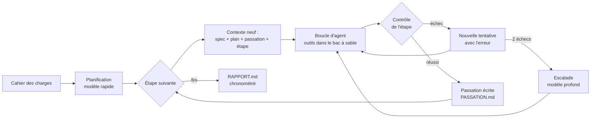

# Pilote — une station d'agents IA 100 % locale

> Projet présenté à l'**ASUS Agent Computer Challenge** (catégorie High-End).
> *English summary at the bottom.*

Ce dépôt contient le **cœur open source** d'une station d'IA privée qui tourne jour et nuit
sur un mini-PC (AMD Ryzen AI Max+ 395 « Strix Halo », 128 Go de mémoire unifiée), sans cloud :

- un **orchestrateur** qui choisit le bon modèle pour chaque demande ;
- une **boucle d'agent** avec outils (fichiers, commandes) : comprendre → agir → vérifier → décider ;
- un **bac à sable** bubblewrap : réseau coupé, système en lecture seule, dossier personnel masqué ;
- **Pilote**, qui mène seul un projet de bout en bout, étape par étape, avec un **contexte neuf
  à chaque étape**, un **contrôle obligatoire** avant d'avancer, une **escalade** vers un modèle
  plus fort en cas d'échec, une **passation écrite** et un **rapport chronométré**.

La station complète (une trentaine de serveurs d'outils MCP, création d'images, de vidéos, de musique
et de 3D, supervision 24 h/24…) est décrite dans [docs/ARCHITECTURE.md](docs/ARCHITECTURE.md).
Ce dépôt en est une réécriture autonome et lisible, **sans aucune dépendance** (Python 3.10+,
bibliothèque standard seulement), pour que n'importe qui puisse la tester sur son propre PC.

## Démo en 3 commandes

Prérequis : Linux (ou macOS/WSL, sans bac à sable bwrap), Python 3.10+, [Ollama](https://ollama.com).

```bash
ollama pull qwen3:30b-a3b            # modèle testé (18 Go) ; qwen3:4b sur une petite machine
git clone https://github.com/Emrys3098/agent-pilote.git && cd agent-pilote
python3 -m agentpilote demo          # Pilote crée, teste et livre une calculatrice RPN
```

Pilote planifie le projet, l'exécute étape par étape dans le bac à sable, vérifie chaque étape
par les tests et écrit dans `demo_output/` : le code produit, `PLAN.json`, `PASSATION.md` et
`RAPPORT.md` (statut, tentatives, modèle utilisé et durée de chaque étape).

Deux résultats réels, obtenus sur la station, sont fournis dans [examples/calculatrice-rpn](examples/calculatrice-rpn) :

| Modèle | Résultat | Durée | Ce qu'on y voit |
|---|---|---|---|
| [`qwen3:30b-a3b`](examples/calculatrice-rpn/resultat-qwen3-30b-a3b) (recommandé) | 3/3 étapes, 8 tests verts, messages d'erreur propres | 17 min, 60 jetons/s | à l'étape 3, le modèle **affirme à tort** que les tests passent : le contrôle du Pilote le dément, la tentative suivante corrige |
| [Qwen3.8-Flash-Next](examples/calculatrice-rpn/resultat-qwen3.8-flash-next) (125B, modèle principal de la station, via Halogen) | 3/3 étapes **du premier coup**, messages en français | 10 min | le plus rapide et le plus propre : c'est ce modèle que vise la station |
| [`qwen3:4b`](examples/calculatrice-rpn/resultat-qwen3-4b) | 3/3 étapes du premier coup, 8 tests verts | 18 min (machine partagée) | limites d'un petit modèle : message « Erreur : Erreur : » en double |

C'est tout l'intérêt du Pilote : ne jamais croire l'agent sur parole, mais vérifier chaque étape.

Les tests du framework tournent **sans aucun modèle** (faux modèle scripté) :

```bash
python3 -m unittest -v
```

## Utilisation

```bash
python3 -m agentpilote check                       # le modèle local répond-il ?
python3 -m agentpilote run MON_PROJET.md -o dossier  # n'importe quel cahier des charges
python3 -m agentpilote chat "!!deep pourquoi ce test échoue ?"   # une demande routée
```

| Variable | Rôle | Défaut |
|---|---|---|
| `AP_BASE_URL` | API compatible OpenAI (Ollama, llama.cpp, vLLM…) | `http://localhost:11434/v1` |
| `AP_MODEL` | modèle rapide, utilisé par défaut | `qwen3:30b-a3b` |
| `AP_DEEP_MODEL` | modèle « profond » (escalade, `!!deep`) | = modèle rapide |
| `AP_DEEP_BASE_URL` | serveur du modèle profond s'il est ailleurs | = `AP_BASE_URL` |
| `AP_NTFY_URL` | notification à chaque étape (ex. sujet ntfy sur votre serveur) | désactivé |

Petite machine : `AP_MODEL=qwen3:4b python3 -m agentpilote demo`. Avec un palier profond : `AP_DEEP_MODEL=gpt-oss:120b`.

## Comment ça marche



| Fichier | Rôle |
|---|---|
| [agentpilote/router.py](agentpilote/router.py) | orchestrateur : `!!deep` / `!!fast`, mots-clés, longueur, escalade |
| [agentpilote/agent.py](agentpilote/agent.py) | boucle d'agent à outils, relance si le modèle oublie d'agir |
| [agentpilote/tools.py](agentpilote/tools.py) | outils : lister, lire, écrire (confinés au projet), exécuter, terminer |
| [agentpilote/sandbox.py](agentpilote/sandbox.py) | bac à sable bubblewrap |
| [agentpilote/pilote.py](agentpilote/pilote.py) | Pilote : plan, étapes, contrôles, escalade, passation, rapport |
| [agentpilote/llm.py](agentpilote/llm.py) | client OpenAI-compatible minimal, mesure jetons/s |

### Pourquoi un contexte neuf à chaque étape ?

Sur les projets longs (des centaines d'étapes sur la station réelle), un agent qui garde tout son
historique finit par dépasser sa fenêtre de contexte, ralentir et se perdre. Pilote repart de zéro
à chaque étape avec seulement ce qui compte, écrit noir sur blanc : le cahier des charges, le plan
coché et la passation. Résultat : la vitesse et la qualité restent constantes du début à la fin,
et un plantage ou une coupure de courant ne fait perdre que l'étape en cours.

### Pourquoi en local ?

Confidentialité (rien ne quitte la machine), disponibilité (fonctionne sans internet), coût
(aucune facturation au jeton pour des projets qui tournent des heures) et contrôle (versions des
modèles figées et mesurées).

## Licence

MIT — voir [LICENSE](LICENSE).

---

## English summary

**Pilote** is the open-source core of a fully local AI agent workstation running 24/7 on an
AMD Strix Halo mini-PC (128 GB unified memory). It contains a model router, a tool-using agent
loop, a bubblewrap sandbox (no network, read-only system, hidden home) and **Pilote**, a runner
that completes long projects step by step with a **fresh context per step**, a **mandatory check**
before moving on, **escalation** to a stronger model after repeated failures, a **written handoff**
and a **timed report**. Zero dependencies (Python 3.10+ standard library).

```bash
ollama pull qwen3:30b-a3b && python3 -m agentpilote demo   # builds, tests and ships an RPN calculator
python3 -m unittest -v                                 # framework tests, no model needed
```

The full workstation (≈30 MCP tool servers, image/video/music/3D generation, 24/7 monitoring)
is described in [docs/ARCHITECTURE.md](docs/ARCHITECTURE.md).
