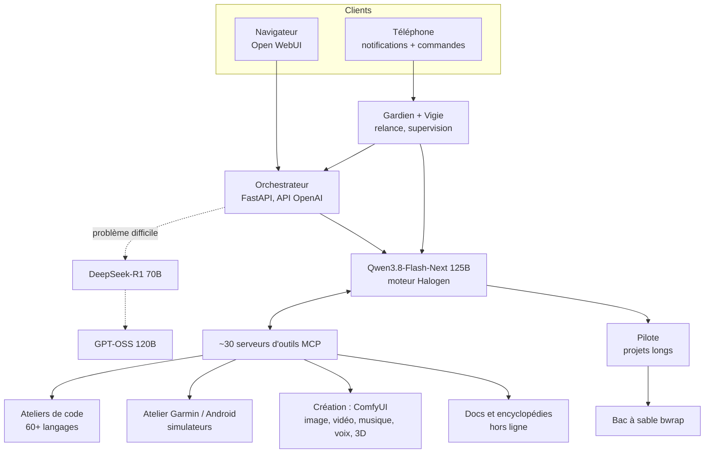

# Architecture de la station complète

Ce dépôt publie le cœur de l'agent. La station dont il est issu tourne en production à la maison
depuis octobre 2026. Ce document la décrit pour le jury ; les services privés (comptes, accès
distant, données personnelles) n'y figurent pas.

## Matériel

| | |
|---|---|
| Machine | Mini-PC GMKtec EVO-X3 |
| Puce | AMD Ryzen AI Max+ 395 « Strix Halo » : 16 cœurs Zen 5, Radeon 8060S intégrée (gfx1151, 40 CU RDNA 3.5), NPU XDNA 2 |
| Mémoire | 128 Go LPDDR5X-8000 **unifiée** (processeur et GPU partagent tout), 256 Go/s théoriques |
| Stockage | SSD NVMe 2 To |
| Extension | port **OCuLink** (PCIe) pour une carte graphique externe |
| Logiciel | Fedora 44, ROCm, systemd, Podman sans root |

La mémoire unifiée permet de charger un modèle de 125 milliards de paramètres (63 Go) sur un
boîtier de bureau silencieux. Sa limite : **tout partage la même puce**.

## Vue d'ensemble

## Les briques

### 1. Les modèles (tous locaux)

- **Qwen3.8-Flash-Next** (125 Md de paramètres, vision incluse), modèle principal, servi par
  **Halogen**, un moteur optimisé pour Strix Halo (décodage spéculatif MTP, table n-gram).
  Mesuré seul : **64 à 77 jetons/s** en génération.
- **DeepSeek-R1 70B** puis **GPT-OSS 120B** (Ollama) : paliers de réflexion pour les problèmes
  que Qwen n'a pas résolus. L'orchestrateur met Qwen en pause, libère la mémoire, interroge le
  palier, puis rend la main à Qwen avec l'analyse.
- **Gemma** : relecture visuelle (captures d'écran d'applications et de jeux).
- Création : Qwen-Image 2.1, FLUX.1, Wan, LTX-2.5, Kandinsky 5 (image et vidéo), ACE-Step
  (musique), Kokoro (voix), SAM 3 (sélection), MoGe (profondeur), modèles image → 3D, Blender.

### 2. L'orchestrateur

Point d'entrée unique, compatible OpenAI. Il route chaque demande (`!!deep`, `!!fast`, longueur,
mots-clés), active à la demande les skills et les outils utiles (les outils ne sont chargés que
quand un rôle les demande, pour garder un contexte court et un cache efficace), et diffuse
l'avancement en direct pendant les bascules. [router.py](../agentpilote/router.py) en est la
version minimale.

### 3. Les outils MCP

Une trentaine de serveurs MCP créés pour Qwen, exposés à Open WebUI via mcpo : ateliers de code
(compilation et exécution dans plus de 60 langages), atelier Garmin (SDK Connect IQ, simulateur,
GPS simulé, installation sur la montre), atelier Android (APK et PWA), création et retouche
locale d'images, montage vidéo, studio de voix, design, documentation locale (équivalent hors
ligne de Context7), encyclopédies Kiwix, recherche SearXNG, bibliothèque de sprites, etc.

### 4. La boucle de l'agent

Comprendre → agir → **vérifier** → décider. Qwen ne déclare un travail fini qu'après un contrôle
réel : tests, compilation, capture d'écran relue par un second modèle, mesure (par exemple la
jouabilité d'un jeu de plateforme). [agent.py](../agentpilote/agent.py).

### 5. Pilote : les projets longs

Pilote découpe un projet en étapes et les exécute une à une, **chaque étape dans un contexte
neuf**, avec une passation écrite, une commande de contrôle, des tentatives limitées et une
escalade. Sur la station, Pilote a mené des projets de plusieurs centaines d'étapes (jeux web,
applications Android, applis de montre, films d'animation 3D) en tournant la nuit, sans
surveillance, et en reprenant tout seul après un redémarrage. [pilote.py](../agentpilote/pilote.py).

### 6. Sécurité

Toutes les commandes de l'agent tournent dans **bubblewrap** : système en lecture seule, réseau
coupé, dossier personnel masqué, seul le dossier du projet est inscriptible.
[sandbox.py](../agentpilote/sandbox.py). Les services tournent sans privilèges root.

### 7. Fiabilité 24 h/24

- **Gardien** : relance automatique des services, reprise des travaux interrompus.
- **Vigie** : supervision matérielle (températures, mémoire, charge) et alertes.
- **Gardien mémoire** : décharge les générateurs inutilisés pour protéger le modèle principal.
- Notifications et commandes depuis le téléphone (ntfy), redémarrage complet sans internet.

### 8. Progrès mesurés

Qwen est évalué en continu sur des bancs d'essai notés (code dans plus de 60 langages, recopie
fidèle d'interfaces, jeux, 3D), chronométrés et rejouables à chaque nouvelle version de modèle.

## La limite actuelle, et ce qu'apporterait une carte dédiée

Tout partage la même puce et la même mémoire. Mesures réelles :

| Situation | Vitesse de Qwen |
|---|---|
| Qwen seul | 64 à 77 jetons/s |
| Rendu Blender en même temps | ≈ 27 jetons/s |

Aujourd'hui, la création (vidéo, rendu 3D) **met Qwen en pause** pour ne pas l'étouffer.
Une **ASUS TURBO Radeon AI PRO R9700 32 Go** branchée en OCuLink, pilotée par la même pile ROCm,
prendrait en charge la création et un second agent, pendant que Qwen garde toute la puce
Strix Halo : de vrais agents en parallèle au lieu d'agents qui attendent leur tour.
